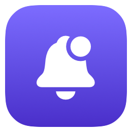
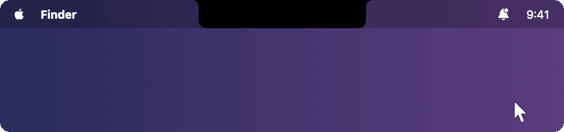
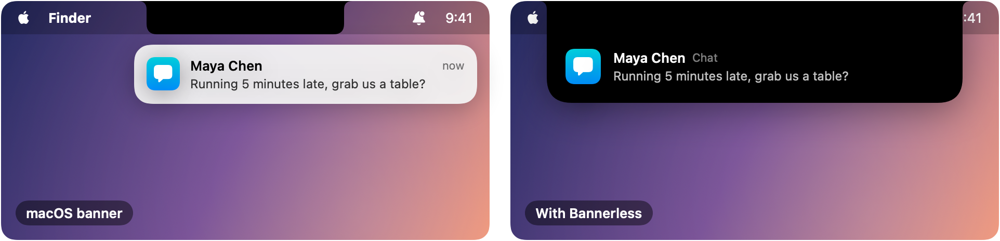
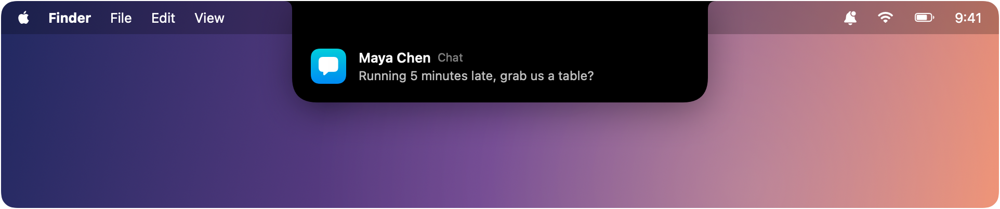
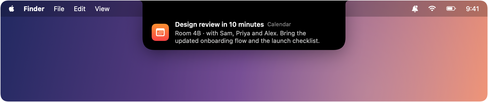
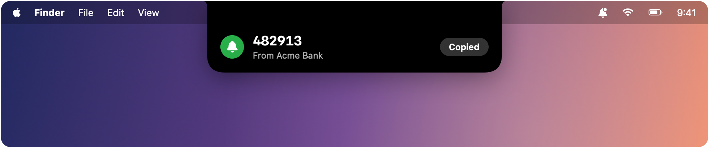
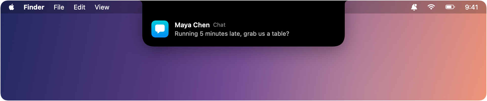
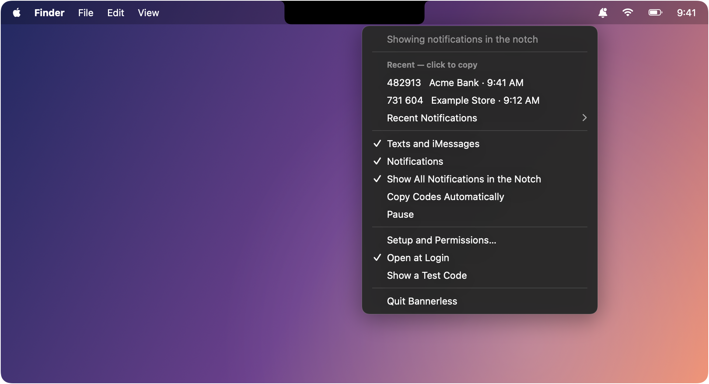

<p align="center">
  
</p>

<h1 align="center">Bannerless</h1>

<p align="center">
  <b>Every notification on your Mac, in the notch, not in a banner.</b><br>
  Sign-in codes get a one-click <b>Copy</b> button.
</p>

<p align="center">
  
  
  
  
</p>

<p align="center">
  
  <br><sub>A message arrives in the notch, then a sign-in code is copied with one click. (Animation)</sub>
</p>

---

Notification banners slide in from the corner of your screen, cover what you're working on, and pile up.
**Bannerless** moves them all into the notch. A short card grows out of the notch, shows the notification,
and tucks itself away. When the notification has a sign-in code, the code is shown big, with a **Copy** button.

- 🔔 **Every notification:** Mac apps, websites, and notifications from your iPhone.
- 🔑 **Sign-in codes, ready to paste:** the code is picked out of the message for you.
- 🖥️ **On the screen you're using:** the notch on a MacBook, the top of the screen on an external display.
- 🔒 **Private by design:** no account, no server, no analytics. Nothing is saved to disk.
- 🆓 **Public domain:** free to use, copy, change and share. Nobody owns it.

## Contents

- [What it looks like](#what-it-looks-like)
- [Install](#install)
- [Setup](#setup)
- [Using Bannerless](#using-bannerless)
- [Privacy](#privacy)
- [FAQ](#faq)
- [Troubleshooting](#troubleshooting)
- [Building from source](#building-from-source)
- [Contributing](#contributing)
- [License](#license)

## What it looks like

### Banners move to the notch

<p align="center">
  
</p>

The banner you'd normally see in the corner never appears. Bannerless shows the same notification in the notch
for a few seconds instead. Move the pointer over it to keep it open.

### A regular notification

<p align="center">
  
</p>

You see the app's icon, the title (often the sender), the app's name, and the message.
**Click the card to open the app.**

### A longer notification

<p align="center">
  
</p>

Longer messages show the first two lines. Open the app for the rest.

### A notification with a sign-in code

<p align="center">
  
</p>

When a message holds a one-time code ("Your code is 482913", "G-552891", "OTP: 4821"…), Bannerless shows the code
itself, large and easy to read, with a **Copy** button. Codes stay a little longer than regular notifications.

<p align="center">
  
</p>

Click **Copy**, or anywhere on the card, and the code is on your clipboard, ready to paste. Turn on
**Copy Codes Automatically** to skip the click.

Codes come from:

- **Notifications:** emails, banking and shopping apps, websites, authenticator apps.
- **Text messages and iMessages:** including texts forwarded from your iPhone.
- **iPhone notifications:** shown on your Mac through iPhone notifications on Mac.

If the same code arrives twice (say by text and by email), it's shown once.

### External displays

<p align="center">
  
</p>

Notifications appear on whichever screen your pointer is on. On a screen without a notch, the card drops down
from the top centre of the menu bar.

### The menu bar

<p align="center">
  
</p>

Click 🔔 in the menu bar to see:

| Item | What it does |
|---|---|
| **Recent codes** | Your last codes. Click one to copy it again. |
| **Recent Notifications** | Your last ten notifications. Click one to open its app. |
| **Texts and iMessages** | Look for codes in incoming texts. |
| **Notifications** | Look at notifications at all. Turn off to pause everything but texts. |
| **Show All Notifications in the Notch** | On: every banner moves to the notch. Off: macOS banners stay as they are, and only codes appear in the notch. |
| **Copy Codes Automatically** | Put each new code on the clipboard straight away. |
| **Pause** | Stop everything until you turn it back on. |
| **Setup and Permissions…** | Check permissions and open the right settings. |
| **Open at Login** | Start Bannerless when you log in (on by default). |
| **Show a Test Code** | See what a code looks like in the notch. |

## Install

You need **macOS 14 Sonoma or later**. Bannerless works best on a MacBook with a notch, and works on any Mac.

### Download

1. Download **Bannerless.zip** from the [latest release](../../releases/latest) and unzip it.
2. Drag **Bannerless.app** into your **Applications** folder.
3. Open it. Because it isn't from the App Store, macOS may say it can't check the developer. If so, open
   **System Settings → Privacy & Security**, scroll down, and click **Open Anyway**.

### Build it yourself

With Apple's free Command Line Tools (`xcode-select --install`):

```bash
git clone https://github.com/vashuteotia123/bannerless.git
cd bannerless
make install
```

This builds the app, copies it to Applications and opens it. Or do it all in one line:

```bash
curl -fsSL https://raw.githubusercontent.com/vashuteotia123/bannerless/main/scripts/install.sh | bash
```

## Setup

When Bannerless first opens, a setup window walks you through two permissions. macOS keeps notifications and
messages private, so it needs your permission before any app can show them somewhere else.

| Permission | Why Bannerless needs it | Where |
|---|---|---|
| **Accessibility** | To see each notification banner as it appears and show it in the notch instead. | System Settings → Privacy & Security → **Accessibility** |
| **Full Disk Access** | To find codes in text messages, and in notifications that didn't show a banner (for example during a Focus). | System Settings → Privacy & Security → **Full Disk Access** |

In each list, switch **Bannerless** on, or click **+** and choose it from Applications. The setup window shows a
green check next to each part once it's working. Bannerless only reads notifications and messages. It never
sends anything, and it never controls other apps.

### Optional: codes from your iPhone

- **Text messages:** on your iPhone, open Settings → Apps → Messages → **Text Message Forwarding** and turn on
  your Mac. Open Messages on the Mac once, signed in with the same Apple Account. iMessages work without this.
- **App notifications:** on your Mac, open System Settings → Notifications and turn on **iPhone notifications**.
  On your iPhone, choose which apps show on the Mac.

## Using Bannerless

There's nothing to do day to day. Notifications appear in the notch, and codes come with a Copy button.

- **Keep a notification open:** move the pointer over the card.
- **Open the app:** click a regular notification.
- **Copy a code:** click **Copy**, or anywhere on a code card.
- **Find something you missed:** open the 🔔 menu for recent codes and notifications.
- **Back to normal banners:** turn off **Show All Notifications in the Notch**.
- **Quiet for a while:** choose **Pause**.

## Privacy

- **Everything stays on your Mac.** Bannerless has no server, no account and no analytics, and it never
  connects to the internet.
- **Nothing is saved.** Recent codes and notifications are kept in memory only and are gone when you quit.
- **It only reads.** Bannerless reads notifications and incoming messages. It never changes, sends or deletes
  your messages.
- **Open source.** Every line is in this repository for anyone to check.

## FAQ

<details>
<summary><b>Will I miss notifications?</b></summary>

No. Every notification still appears, just in the notch instead of the corner, and your last ten are kept in the
🔔 menu. If you'd rather keep the standard banners, turn off **Show All Notifications in the Notch**, and you'll
still get codes in the notch.
</details>

<details>
<summary><b>Do notifications still go to Notification Center?</b></summary>

Notifications shown in the notch are cleared from the corner, so most won't stay in Notification Center's list.
Use the 🔔 menu's **Recent Notifications** instead. Notifications that never showed a banner (during a Focus,
for example) stay in Notification Center as usual.
</details>

<details>
<summary><b>Can I reply to a message from the notch?</b></summary>

Not yet. Click the notification to open the app and reply there. Buttons like Reply or Snooze from standard
banners aren't shown in the notch.
</details>

<details>
<summary><b>Why do I still hear the notification sound?</b></summary>

macOS plays the sound as the notification arrives, so the sound stays even though the banner doesn't. To
silence an app, turn its sound off in System Settings → Notifications.
</details>

<details>
<summary><b>What about alerts that stay on screen until I click them?</b></summary>

Bannerless leaves those alone, so you can still use their buttons.
</details>

<details>
<summary><b>Does it work on a Mac without a notch?</b></summary>

Yes. The card drops down from the top centre of the screen instead.
</details>

<details>
<summary><b>Which code formats does it recognise?</b></summary>

Common ones: "482913 is your verification code", "Your OTP is 4821", `G-552891`, `123-456`, codes in Android-style
texts, and codes in bank texts that also mention amounts or masked card numbers. Order numbers, amounts, dates
and phone numbers are ignored.
</details>

<details>
<summary><b>Does it work in languages other than English?</b></summary>

Notifications are shown in the notch in any language. Code detection looks for common English words near the
code ("code", "OTP", "verification"…). On a Mac set to a language other than English, banners may also stay in
Notification Center after they're shown in the notch.
</details>

## Troubleshooting

**Notifications still show as normal banners.** Open **Setup and Permissions…** from the 🔔 menu. If
Accessibility isn't marked as working, open System Settings → Privacy & Security → Accessibility, select
Bannerless, remove it with **–**, and add it again with **+**.

**Codes from texts don't appear.** Check that Full Disk Access is working in **Setup and Permissions…**, and that
Text Message Forwarding is on (see [Setup](#optional-codes-from-your-iphone)).

**It stopped working after an update.** Each build you make yourself counts as a new app to macOS. Remove
Bannerless from **Accessibility** and **Full Disk Access** with **–**, then add it again with **+**.

**Something else.** Bannerless can write a diagnostic report. It holds only structure and masked text (digits
become `9`, words become `x`), so it's safe to attach to an issue:

```bash
open -n -a Bannerless --args --diagnose ~/Desktop/bannerless-report.txt
```

## Building from source

```bash
make test      # run the tests
make app       # build dist/Bannerless.app
make install   # build, copy to Applications and open
make run       # build and open without installing
```

The app is built with Swift Package Manager and needs only the Command Line Tools, not Xcode. The README images
are drawn by `swift scripts/render-docs.swift docs/images`, so they always match the app's design.

```
Sources/Bannerless/   the menu bar app
Sources/NotchUI/      the notch
Sources/CodeCore/     finding codes in notifications and messages
Tests/                tests
scripts/              build, install, icon and README image scripts
```

## Contributing

Issues and pull requests are welcome. Please run `make test` before opening a pull request, and never include
real notifications, messages or codes in issues, tests or screenshots. Use made-up examples like the ones above.

## License

Bannerless is released into the public domain under the [Unlicense](UNLICENSE). Use it however you like, no
permission needed.
